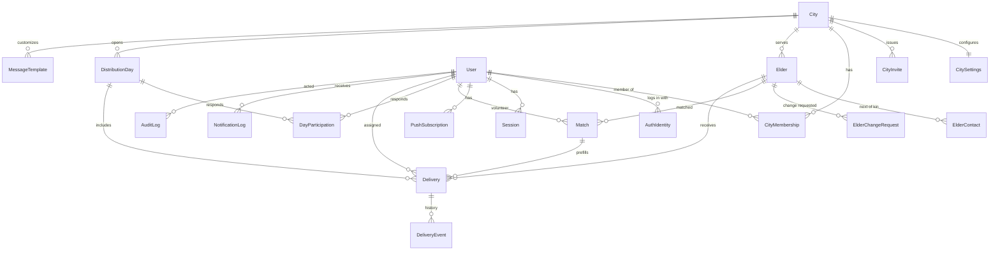

# Data Model (MVP)

This document is the approved product data model for Giving Day. It is
**documentation only**. No Prisma schema or migrations are implied by this
file. Implementation will follow later.

Source of truth: owner-approved schema proposal (2026-10-15), plus the
follow-up decisions in [PRD Resolved Decisions](./PRD.md#resolved-decisions).

Related:

- [RBAC and city scoping](./rbac.md)
- [ADR 0019: Multi-tenant city scoping](./adr/0019-multi-tenant-city-scoping.md)
- [ADR 0020: OAuth and join-link authentication](./adr/0020-oauth-join-link-auth.md)
- [ADR 0021: Provider-agnostic Web Push (VAPID)](./adr/0021-web-push-vapid.md)
- [ADR 0007: No personal data in the repository](./adr/0007-no-personal-data-in-repo.md)

Examples below use **fake data only**.

## Conventions

- Every table has `id` (`uuid`), `createdAt` (`timestamptz`, default now),
  and `updatedAt` (`timestamptz`).
- Users, elders, and cities are archived with `archivedAt`. They are never
  hard-deleted.
- Every city-owned table has `cityId uuid NOT NULL`. Indexes on those tables
  start with `cityId`.
- Phone numbers are stored in E.164 and validated with Zod in
  `packages/shared`.
- Instants are `timestamptz`. Day dates are `date`. Hours are `time`,
  interpreted in the city's timezone (default `Asia/Jerusalem`).
- Enum keys are English. Labels come from i18n. City names are stored in
  both Hebrew and English.
- Seeds use fake data only (ADR 0007).

## Enums

| Enum                  | Values                                                                                                                                        |
| --------------------- | --------------------------------------------------------------------------------------------------------------------------------------------- |
| `Locale`              | `he`, `en`                                                                                                                                    |
| `ThemePref`           | `system`, `light`, `dark`                                                                                                                     |
| `AuthProvider`        | `google`, `facebook`, `apple` (`apple` is later)                                                                                              |
| `CityRole`            | `coordinator`, `volunteer`                                                                                                                    |
| `MembershipStatus`    | `pending`, `active`, `paused`, `removed`                                                                                                      |
| `ElderStatus`         | `active`, `paused`, `hospitalized`, `moved`, `deceased`, `removed`                                                                            |
| `GeocodeStatus`       | `pending`, `ok`, `failed`, `manual`                                                                                                           |
| `ContactRelation`     | `child`, `spouse`, `sibling`, `caregiver`, `social_worker`, `neighbor`, `other`                                                               |
| `ChangeRequestStatus` | `pending`, `approved`, `rejected`, `superseded`                                                                                               |
| `MatchType`           | `permanent`, `one_time`                                                                                                                       |
| `MatchEndReason`      | `volunteer_left`, `elder_inactive`, `reassigned`, `other`                                                                                     |
| `DayStatus`           | `draft`, `published`, `in_progress`, `closed`, `cancelled`                                                                                    |
| `ParticipationStatus` | `invited`, `confirmed`, `declined`, `cancelled`, `no_show`, `attended`                                                                        |
| `DeliveryStatus`      | `unassigned`, `assigned`, `picked`, `delivered`, `not_delivered`, `cancelled`                                                                 |
| `NotDeliveredReason`  | `not_home`, `refused`, `wrong_address`, `hospitalized`, `deceased`, `other`                                                                   |
| `DeliveryResolution`  | `redeliver`, `reassigned`, `skipped`, `follow_up`                                                                                             |
| `TemplateKey`         | `day_invite`, `confirm_reminder`, `unpicked_warning`, `final_status_reminder`, `reassigned`, `change_request_reviewed`, `membership_approved` |
| `NotificationChannel` | `push` (SMS / WhatsApp later)                                                                                                                 |
| `NotificationStatus`  | `sent`, `failed`, `clicked`                                                                                                                   |

## Entities (MVP)

### City

| Field              | Type         | Notes                                      |
| ------------------ | ------------ | ------------------------------------------ |
| `slug`             | text unique  | URL-safe city key                          |
| `nameHe`, `nameEn` | text         | Display names                              |
| `timezone`         | text         | Default `Asia/Jerusalem`                   |
| `isActive`         | bool         | Inactive cities are hidden from day-to-day |
| `archivedAt`       | timestamptz? | Soft delete                                |

### CitySettings (one per city)

| Field                          | Type         | Default                       |
| ------------------------------ | ------------ | ----------------------------- |
| `centerAddress`                | text         | Distribution center           |
| `centerLat`, `centerLng`       | decimal(9,6) |                               |
| `defaultStartTime`             | time         | `09:00`                       |
| `defaultEndTime`               | time         | `14:00`                       |
| `confirmReminderAfterHours`    | int          | `24`                          |
| `unpickedPushMinutesBeforeEnd` | int          | `60`                          |
| `missingFinalStatusWaitHours`  | int          | `72`                          |
| `defaultLocale`                | `Locale`     | `he`                          |
| `defaultTheme`                 | text         | `wisteria-mint`               |
| `orgName`, `logoUrl`           | text?        |                               |
| `extra`                        | jsonb        | Other UI knobs; Zod-validated |

### User

Anyone who logs in. **Elders are not users.**

| Field          | Type         | Notes                                                                 |
| -------------- | ------------ | --------------------------------------------------------------------- |
| `firstName`    | text?        | Required once onboarding is done                                      |
| `lastName`     | text?        | Required once onboarding is done                                      |
| `phone`        | text?        | E.164. Required once onboarding is done                               |
| `email`        | citext?      | Optional. May come from the login provider                            |
| `birthDate`    | date?        | Optional                                                              |
| `locale`       | `Locale`     | Preferred locale. Set during onboarding. Default `he`                 |
| `themePref`    | `ThemePref`  | Default `system`                                                      |
| `isSuperAdmin` | bool         | Default `false`. Set only from the seed CLI or by another super admin |
| `onboardedAt`  | timestamptz? | `null` means onboarding blocks the rest of the app                    |
| `lastLoginAt`  | timestamptz? |                                                                       |
| `archivedAt`   | timestamptz? |                                                                       |

There is no `fullName` column and no `privacyAcceptedAt`. Display name is
`firstName` + `lastName`. Onboarding is **mandatory** and blocks the app
until `firstName`, `lastName`, and `phone` are set and `onboardedAt` is
written. At the end of onboarding the app prompts for notification
permission and for PWA install (or iOS add-to-home-screen instructions).

### AuthIdentity

| Field             | Type           | Notes                                      |
| ----------------- | -------------- | ------------------------------------------ |
| `userId`          | uuid           |                                            |
| `provider`        | `AuthProvider` | `google`, `facebook` in MVP; `apple` later |
| `providerSubject` | text           | Provider's subject identifier              |

Unique on `(provider, providerSubject)`. One user can link several providers.

### Session

| Field              | Type         | Notes |
| ------------------ | ------------ | ----- |
| `userId`           | uuid         |       |
| `refreshTokenHash` | text         |       |
| `userAgent`        | text         |       |
| `expiresAt`        | timestamptz  |       |
| `revokedAt`        | timestamptz? |       |

### CityInvite

Permanent shareable join link: **one active link per city and role**.

| Field         | Type         | Notes                                            |
| ------------- | ------------ | ------------------------------------------------ |
| `cityId`      | uuid         |                                                  |
| `role`        | `CityRole`   | `coordinator` or `volunteer`                     |
| `tokenHash`   | text unique  | Raw token is shown once; only the hash is stored |
| `createdById` | uuid         |                                                  |
| `expiresAt`   | timestamptz? | Default `null` (no expiry)                       |
| `maxUses`     | int?         | Default `null` (no use cap)                      |
| `usedCount`   | int          | How many times the link was redeemed             |
| `revokedAt`   | timestamptz? | Set when a coordinator revokes the current link  |

Owner decision: the join link is a **permanent, shareable** URL per city
and role. It does **not** expire after 48 hours and has **no `maxUses`**
by default. A coordinator can **revoke** it and **regenerate** a new
token (the old URL stops working). The landing page has an **Install
app** button (PWA install prompt; iOS add-to-home-screen instructions).
Redeeming still creates a **pending** membership. A coordinator must
approve (one tap). A leaked link cannot grant access by itself.

Partial unique: one current invite per `(cityId, role)` where
`revokedAt IS NULL`.

### CityMembership

| Field              | Type               | Notes                                                                           |
| ------------------ | ------------------ | ------------------------------------------------------------------------------- |
| `cityId`, `userId` | uuid               | Unique `(cityId, userId)`                                                       |
| `role`             | `CityRole`         |                                                                                 |
| `status`           | `MembershipStatus` | `pending` = coordinator has not approved yet                                    |
| `inviteId`         | uuid?              | Invite that created this membership                                             |
| `approvedById`     | uuid?              |                                                                                 |
| `approvedAt`       | timestamptz?       |                                                                                 |
| `homeArea`         | text?              | Volunteer neighborhood only. No exact home address. Used for nearby suggestions |
| `coordinatorNotes` | text?              | Coordinators only                                                               |

The same person can be a coordinator in one city and a volunteer in another.

### Elder

| Field                            | Type            | Notes                                                                                                                                             |
| -------------------------------- | --------------- | ------------------------------------------------------------------------------------------------------------------------------------------------- |
| `cityId`                         | uuid            |                                                                                                                                                   |
| `fullName`                       | text            |                                                                                                                                                   |
| `phone`, `phoneAlt`              | text?           | E.164                                                                                                                                             |
| `language`                       | text            | Default `he`                                                                                                                                      |
| `street`, `houseNumber`          | text            |                                                                                                                                                   |
| `entrance`, `floor`, `apartment` | text?           |                                                                                                                                                   |
| `buildingCode`                   | text?           | Sensitive; time-boxed volunteer visibility                                                                                                        |
| `addressNotes`                   | text?           |                                                                                                                                                   |
| `lat`, `lng`                     | decimal(9,6)?   |                                                                                                                                                   |
| `geocodeStatus`                  | `GeocodeStatus` |                                                                                                                                                   |
| `status`                         | `ElderStatus`   | Only `active` elders get deliveries                                                                                                               |
| `statusReason`                   | text?           |                                                                                                                                                   |
| `notes`                          | text?           | One general field. Visible to the assigned volunteer and to coordinators. Example: "entrance is around the back", "hard of hearing, knock loudly" |
| `archivedAt`                     | timestamptz?    |                                                                                                                                                   |

Index: `(cityId, status)`.

There are no `dietaryNotes`, `accessibilityFlags`, `volunteerNotes`, or
`coordinatorNotes`. Practical details go in `notes`.

**Not stored on Elder:** national ID number, date of birth, diagnoses, or
structured dietary / accessibility enums. Volunteer home street addresses
are not stored (neighborhood `homeArea` only).

### ElderContact

Next of kin. Visible to the **assigned volunteer** (so they can call if
the elder does not answer) and to coordinators.

| Field       | Type              | Notes                                  |
| ----------- | ----------------- | -------------------------------------- |
| `elderId`   | uuid              |                                        |
| `cityId`    | uuid              |                                        |
| `name`      | text              |                                        |
| `relation`  | `ContactRelation` |                                        |
| `phone`     | text              |                                        |
| `isPrimary` | bool              | Usually one contact; a few are allowed |

### ElderChangeRequest

| Field           | Type                  | Notes                                                            |
| --------------- | --------------------- | ---------------------------------------------------------------- |
| `cityId`        | uuid                  |                                                                  |
| `elderId`       | uuid                  |                                                                  |
| `requestedById` | uuid                  | Volunteer who submitted the request                              |
| `changes`       | jsonb                 | `{ field: { from, to } }`. Only allow-listed fields; Zod-checked |
| `reason`        | text?                 |                                                                  |
| `status`        | `ChangeRequestStatus` |                                                                  |
| `reviewedById`  | uuid?                 |                                                                  |
| `reviewedAt`    | timestamptz?          |                                                                  |
| `reviewNote`    | text?                 |                                                                  |

### Match

A volunteer paired with an elder.

| Field         | Type              | Notes                              |
| ------------- | ----------------- | ---------------------------------- |
| `cityId`      | uuid              |                                    |
| `elderId`     | uuid              |                                    |
| `volunteerId` | uuid              | User id of the volunteer           |
| `type`        | `MatchType`       | `permanent` or `one_time`          |
| `dayId`       | uuid?             | Required when `type` is `one_time` |
| `startsAt`    | date              |                                    |
| `endsAt`      | date?             |                                    |
| `endReason`   | `MatchEndReason?` |                                    |

Constraint: an elder can have only one current permanent match (partial
unique where `type = 'permanent' AND endsAt IS NULL`).

### DistributionDay

| Field                  | Type         | Notes                                     |
| ---------------------- | ------------ | ----------------------------------------- |
| `cityId`               | uuid         |                                           |
| `date`                 | date         | Unique `(cityId, date)`                   |
| `startTime`, `endTime` | time         | Default from city settings                |
| `notesForVolunteers`   | text?        | Shown on the confirmation screen (Flow 2) |
| `internalNotes`        | text?        | Coordinators only                         |
| `addOns`               | text[]       | Seasonal extras, e.g. holiday honey       |
| `status`               | `DayStatus`  |                                           |
| `publishedAt`          | timestamptz? |                                           |
| `closedAt`             | timestamptz? |                                           |
| `createdById`          | uuid         |                                           |

When a day is created, the system **prefills** one `Delivery` for each
active elder in the city. Elders with a current permanent match get
`volunteerId` set from that match. Elders with no current permanent match
still get a row with `volunteerId` null so they appear on the coordinator's
"Needs a volunteer" list and can be assigned. Archived and non-active
elders are excluded. The coordinator then adjusts the list. This is a
prefill, **not** automatic reassignment. Prefill is idempotent: unique
`(dayId, elderId)` prevents duplicate rows.

### DayParticipation

| Field          | Type                  | Notes                                                                       |
| -------------- | --------------------- | --------------------------------------------------------------------------- |
| `cityId`       | uuid                  |                                                                             |
| `dayId`        | uuid                  |                                                                             |
| `volunteerId`  | uuid                  | Unique `(dayId, volunteerId)`                                               |
| `status`       | `ParticipationStatus` |                                                                             |
| `respondedAt`  | timestamptz?          |                                                                             |
| `cancelReason` | text?                 | Optional when the volunteer declines or cancels. Visible to the coordinator |
| `finishedAt`   | timestamptz?          | When set, the second fireworks screen shows                                 |

### Delivery

One standard package for one elder on one day.

| Field                | Type                  | Notes                                          |
| -------------------- | --------------------- | ---------------------------------------------- |
| `cityId`             | uuid                  |                                                |
| `dayId`              | uuid                  | Unique `(dayId, elderId)`                      |
| `elderId`            | uuid                  |                                                |
| `volunteerId`        | uuid?                 | `null` puts it on the "Needs a volunteer" list |
| `matchId`            | uuid?                 | Prefill source                                 |
| `status`             | `DeliveryStatus`      |                                                |
| `notDeliveredReason` | `NotDeliveredReason?` |                                                |
| `note`               | text?                 | Required when status is `not_delivered`        |
| `routeOrder`         | int?                  |                                                |
| `assignedAt`         | timestamptz?          |                                                |
| `pickedAt`           | timestamptz?          |                                                |
| `finalAt`            | timestamptz?          |                                                |
| `resolution`         | `DeliveryResolution?` | Coordinator follow-up after `not_delivered`    |
| `resolvedById`       | uuid?                 |                                                |

Indexes: `(dayId, volunteerId)`, `(dayId, status)`.

**Decline / cancel (owner-approved):** when a volunteer declines or cancels
participation, they can enter a `cancelReason` (visible to the
coordinator). Every delivery still assigned to them on that day is moved
to `volunteerId = null` and `status = unassigned`. They appear on the
coordinator's "Needs a volunteer" list. The system **never** auto-reassigns
them to another volunteer.

### DeliveryEvent

Append-only history. Rows are never edited.

| Field             | Type        | Notes |
| ----------------- | ----------- | ----- |
| `deliveryId`      | uuid        |       |
| `fromStatus`      | text        |       |
| `toStatus`        | text        |       |
| `fromVolunteerId` | uuid?       |       |
| `toVolunteerId`   | uuid?       |       |
| `actorId`         | uuid        |       |
| `note`            | text?       |       |
| `at`              | timestamptz |       |

### MessageTemplate

| Field    | Type          | Notes                   |
| -------- | ------------- | ----------------------- |
| `cityId` | uuid?         | `null` = global default |
| `key`    | `TemplateKey` |                         |
| `locale` | `Locale`      |                         |
| `title`  | text          |                         |
| `body`   | text          | `{{placeholders}}`      |

Unique on `(cityId, key, locale)`.

### PushSubscription

| Field           | Type         | Notes                            |
| --------------- | ------------ | -------------------------------- |
| `userId`        | uuid         |                                  |
| `endpoint`      | text unique  |                                  |
| `p256dh`        | text         |                                  |
| `auth`          | text         |                                  |
| `userAgent`     | text         |                                  |
| `lastSuccessAt` | timestamptz? |                                  |
| `failedCount`   | int          |                                  |
| `disabledAt`    | timestamptz? | Set when push returns 404 or 410 |

### NotificationLog

| Field         | Type                  | Notes            |
| ------------- | --------------------- | ---------------- |
| `cityId`      | uuid                  |                  |
| `userId`      | uuid                  |                  |
| `templateKey` | `TemplateKey`         |                  |
| `channel`     | `NotificationChannel` | MVP: `push` only |
| `dayId`       | uuid?                 |                  |
| `deliveryId`  | uuid?                 |                  |
| `dedupeKey`   | text unique           |                  |
| `status`      | `NotificationStatus`  |                  |
| `error`       | text?                 |                  |
| `sentAt`      | timestamptz           |                  |

### AuditLog

Rows are never updated or deleted.

| Field      | Type        | Notes                                                             |
| ---------- | ----------- | ----------------------------------------------------------------- |
| `cityId`   | uuid?       |                                                                   |
| `actorId`  | uuid        |                                                                   |
| `action`   | text        | e.g. `elder.update`, `elder.view_pii`, `membership.approve`       |
| `entity`   | text        |                                                                   |
| `entityId` | uuid        |                                                                   |
| `diff`     | jsonb       | Personal values shown only as `"changed"`, never as the raw value |
| `at`       | timestamptz |                                                                   |

## Constraints (summary)

- Unique `(cityId, date)` on `DistributionDay`.
- Unique `(dayId, elderId)` on `Delivery`.
- Unique `(dayId, volunteerId)` on `DayParticipation`.
- Unique `(cityId, userId)` on `CityMembership`.
- Unique `(provider, providerSubject)` on `AuthIdentity`.
- Unique `(cityId, key, locale)` on `MessageTemplate`.
- Partial unique: one current permanent `Match` per elder.
- At most one active `CityInvite` per `(cityId, role)` (`revokedAt IS NULL`).
  Default: no `expiresAt`, no `maxUses`.
- Only `ElderStatus.active` elders receive prefilled deliveries.
- `Delivery.note` required when status is `not_delivered`.
- City-owned rows always carry `cityId`.

## ER diagram

## Privacy constraints (data)

- **Data owner:** Latet. Legal details are deferred.
- **Not stored:** national ID number, diagnoses, volunteer home street
  addresses. Optional user `birthDate` is collected only if the person
  enters it at onboarding. Elders have no date of birth field.
- **Building code and elder phone:** volunteers see them only while a
  delivery is active (from day publish until a final status). Each view is
  logged (`elder.view_pii`).
- **Retention:** keep data at least 2 years. No automatic purge in MVP.
- **Hosting:** EU region only. Sentry strips names, phones, and addresses
  (ADR 0018).
- **Audit diffs** never store raw personal values.

## MVP vs later

### In MVP

- Multi-city tenancy with `cityId` on city-owned tables
- Roles: Volunteer, City coordinator, Super admin
- Google and Facebook OAuth; mandatory onboarding (`firstName`, `lastName`,
  `phone`, locale; optional `birthDate` and `email`); then notification
  and install prompts
- Permanent join links per city and role (revoke / regenerate); approval
  still required
- Permanent and one-time matches; day prefill for every active elder
  (assigned from current permanent matches, unmatched as needing a volunteer)
- Confirm / decline / cancel with optional `cancelReason`; unassign on
  decline or cancel
- Pickup and delivery statuses; coordinator-led reassignment
- Push notifications and city-scoped settings
- Soft archive; append-only delivery events and audit log

### Later (not in this schema's implementation scope)

- Apple sign-in
- Retention jobs (purge archived elders; anonymize old delivery history)
- Exporting or deleting a person's data
- Append-only history of elder notes
- Delivery swap requests
- Report snapshots
- SMS and WhatsApp channels
- CSV import and export
- Global `AppSettings`
- Volunteer availability beyond confirm or decline
